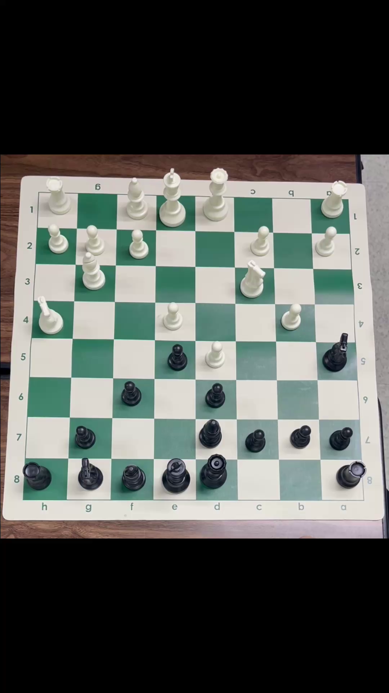

# allamaraine — Chess Move Recorder from Video

> **RETROACTIVE UPLOAD.**
> This work was done in **November–December 2024**.
> It was uploaded to GitHub on **2026-11-19** as an archive.
> The commit date is the upload date, not the date of the work.
> The file modification times in the original folder show the real 2024 dates.

A computer-vision pipeline that watches a video of a real chess game and writes
the moves as PGN.

- Course: Digital Image Processing, Chulalongkorn University (M.S. Computer Science)
- Lecturer: Dr. Punnarai Siricharoen
- Result in the class YOLO chess competition: **3rd overall** across all sections, **1st among master's students**



---

## Pipeline

Each video goes through these stages (see `src_allamaraine_final.ipynb`):

| Stage | Method | What it gives |
|-------|--------|---------------|
| 1. Grid detection | Canny edges + Hough lines, then select lines by spacing from the board center | the 9 vertical and 9 horizontal lines of the 8×8 board |
| 2. Hand detection | pixel-change mask inside the board area | frames where a hand covers the board are skipped |
| 3. Rotation detection | EasyOCR reads the `a–h` / `1–8` labels on the board edge | board orientation, used to name the squares |
| 4. Piece detection | YOLOv8, custom-trained on 12 classes (6 pieces × 2 colors) | piece type, color, and box center per frame |
| 5. Board state | box centers are mapped to squares; votes are summed over a window of frames | a stable board state for white and black |
| 6. Move detection | compare the new board state with the old one (missing / appeared pieces) | moves and captures |
| 7. PGN output | convert moves to square names using the detected rotation | PGN string per video |

---

## Files

| File | Purpose |
|------|---------|
| `src_allamaraine_final.ipynb` | **final submitted version** (Colab, 2024-12-10). Tuned thresholds, uses the trained weights, runs all test videos |
| `src_allamaraine.ipynb` | earlier full-pipeline draft (2024-12-01) |
| `src_gridDetection.ipynb` | development of stage 1 (board grid) |
| `src_tileLabel.ipynb` | square / tile labeling |
| `src_labelDetect.ipynb` | edge-label OCR (stage 3) |
| `src_boardData.ipynb` | board state and voting (stage 5) |
| `src_frameNumberDetect.ipynb`, `src_motion_detect.ipynb` | frame and motion experiments |
| `src_capImage.ipynb` | capture frames from video for labeling |
| `src_chess555.ipynb` | first YOLOv7 experiment |
| `*_backup.ipynb`, `*_back_up.ipynb` | older copies kept as-is |
| `data.yaml`, `dataset/test.yaml` | YOLO dataset configs |
| `examplePic/` | one sample frame per test video |

- LIMIT: the notebooks are archived as they were at the end of the course. Some cells in the final notebook were still being edited, so they may not run without small fixes.
- LIMIT: paths point to the original Google Drive / local folders. Change them before running.

---

## Not included (large files)

GitHub rejects files over 100 MB, and the full folder is about 20 GB.
These parts are kept offline and are **not** in this repo:

| Item | Size | Reason |
|------|------|--------|
| `vdo/`, `vdo.zip` | ~2.2 GB | course test videos (provided by the class, not mine to share) |
| `out_vdo/`, `out_withframeNumber/`, `out_withHandMask*/`, `outVideoFromgg/` | ~6.7 GB | debug output videos |
| `dataset/train`, `dataset/valid` | ~6.2 GB | labeled training images |
| `dataset/yolov7.pt` | 76 MB | public pretrained YOLOv7 weights |
| trained YOLOv8 weights (`last.pt`) | — | kept with the final results, not in this folder |
| `raw.zip` | 17 MB | raw labeling data |
| `yolov7_env/` | 5.8 GB | Python virtual environment |

---

## Requirements

```bash
pip install ultralytics easyocr opencv-python numpy matplotlib pillow
```
